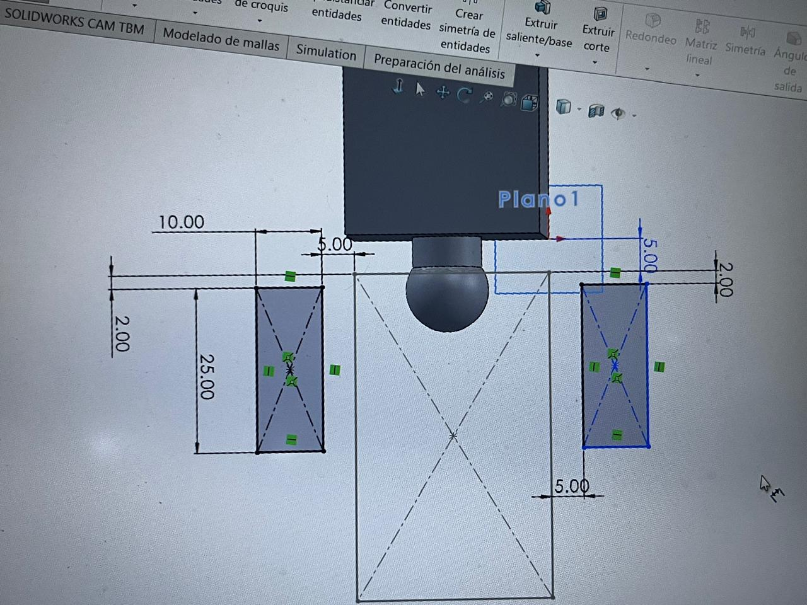
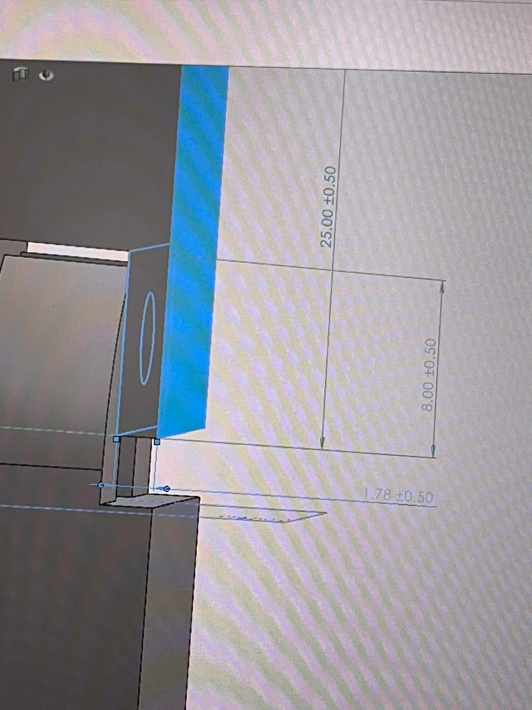
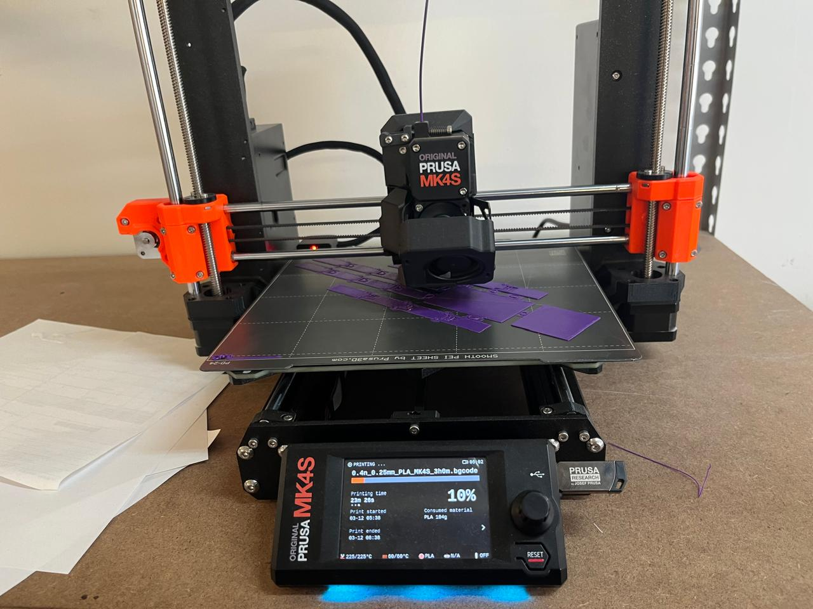
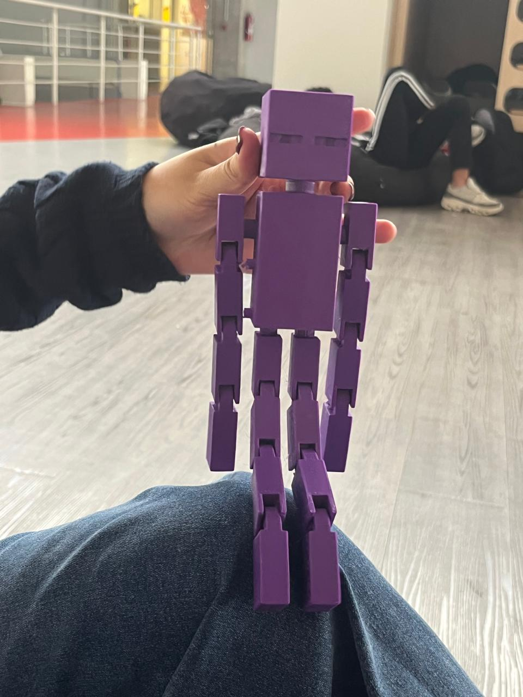

# Manufactura Aditiva e Impresión 3D

**Institución:** IBERO Puebla 
**Clase:** Proyecto de Ingenieria I
**Fecha:** 18 de Septiembre de 2026

---

## 1. Introducción a las Tecnologías de Manufactura Aditiva

La manufactura aditiva abarca todos los procesos donde se fabrican objetos tridimensionales añadiendo material capa por capa a partir de un archivo digital CAD. A diferencia de los métodos sustractivos (como el maquinado CNC), la impresión 3D optimiza el uso de material y permite crear geometrías complejas que serían imposibles de fabricar de forma convencional.
Aquí tienes el código completo en formato Markdown actualizado, incluyendo la lista extendida de las **8 tecnologías de impresión 3D** y el inventario detallado de los **27 equipos del FabLab Puebla**:

---


### Clasificación de Tecnologías de Impresión 3D

- **Stereolithography (SLA):** Emplea un láser UV para curar y solidificar resina fotopolimérica líquida capa por capa. Destaca por su alta precisión y acabado superficial liso.
- **Selective Laser Sintering (SLS):** Utiliza un láser de alta potencia para fusionar pequeñas partículas de polvo termoplástico (generalmente nailon). No requiere estructuras de soporte debido a que el polvo no sinterizado actúa como sustento.
- **Fused Deposition Modeling (FDM):** Es la tecnología más común. Extruye un filamento termoplástico a través de una boquilla caliente, depositando el material capa por capa sobre una plataforma.
- **Digital Light Processing (DLP):** Similar a SLA, pero utiliza un proyector de luz digital para curar una capa completa de resina en un solo destello, aumentando significativamente la velocidad de impresión.
- **Multi Jet Fusion (MJF):** Aplica agentes aglutinantes y de detalle sobre un lecho de polvo termoplástico, los cuales se activan con lámparas infrarrojas para fusionar el material.
- **PolyJet:** Funciona de forma similar a una impresora de inyección de tinta, pulverizando fotopolímeros líquidos sobre una bandeja que se curan instantáneamente con luz UV.
- **Direct Metal Laser Sintering (DMLS):** Tecnología para componentes metálicos que sinteriza polvo de metal utilizando un láser de fibra.
- **Electron Beam Melting (EBM):** Utiliza un haz de electrones en un entorno de alto vacío para fundir polvo metálico, ideal para aplicaciones aeroespaciales y médicas.

---

## 2. Capacidad Operativa en FabLab Puebla

El laboratorio FabLab Puebla cuenta con un parque industrial de **27 impresoras 3D**, enfocadas principalmente en las tecnologías FDM, SLA y MSLA/DLP.

### Inventario de Equipos

1. **Ender 3 (14 unidades):** Equipos FDM versátiles y económicos, ampliamente utilizados para prototipado rápido y pruebas conceptuales.
2. **Sindoh 3DWOX (5 unidades):** Impresoras FDM de cabina cerrada, optimizadas para el entorno educativo debido a su estabilidad térmica y seguridad.
3. **Ultimaker 2+ (2 unidades):** Impresoras FDM profesionales reconocidas por su fiabilidad y precisión en tolerancias dimensionales.
4. **Elegoo Mars 3 (1 unidad):** Impresora MSLA (Resina) ideal para piezas de dimensiones reducidas que requieren alta resolución.
5. **Elegoo Saturn 2 (1 unidad):** Impresora MSLA con volumen de impresión ampliado para lotes de producción o piezas de resina de mayor tamaño.
6. **Anycubic Photon Mono M5S (1 unidad):** Impresora MSLA de alta velocidad con pantalla monocromática de alta definición.
7. **Formlabs Form 1 (1 unidad):** Impresora SLA de grado profesional para prototipos de alta precisión geométrica.
8. **ROSTOCK MAX™ V3 (1 unidad):** Impresora FDM tipo Delta, caracterizada por su alta velocidad de desplazamiento y amplio volumen cilíndrico Z.
9. **Stratasys (1 unidad):** Equipo FDM industrial para aplicaciones avanzadas con materiales de grado de ingeniería.

---

## 3. Guía de Materiales para Impresión FDM

### Criterios de Selección (Ventajas y Requerimientos de Hardware)

| Material | Ventajas Principales | Temperatura de Impresión | Requerimientos de Hardware |
| :--- | :--- | :---: | :--- |
| **PLA** | Fácil de imprimir, baja deformación térmica, biodegradable. | 190°C – 210°C | Cama fría o templada (50°C - 60°C). |
| **ABS** | Mayor resistencia mecánica e impacto, soporta altas temperaturas. | 220°C – 250°C | Cama caliente (90°C - 100°C) y espacio cerrado (evita *warping*). |
| **PETG** | Excelente tenacidad, resistencia química y flexibilidad moderada. | 230°C – 250°C | Cama caliente (70°C - 80°C) y buena calibración de retracción. |
| **TPU (Flex)** | Alta elasticidad, resistencia al desgaste y absorción de impactos. | 210°C – 230°C | Extrusor de tracción directa (*direct drive*) recomendado. |

---

## 4. Reglas de Diseño para Manufactura Aditiva (DfAM)

Para asegurar el éxito en la impresión de piezas funcionales, se deben seguir principios específicos de diseño:
1. **Ángulo de Voladizo (*Overhangs*):** Evitar ángulos mayores a $45^{\circ}$ respecto a la vertical sin el uso previo de estructuras de soporte.
2. **Tolerancias de Ensamble (*Clearance*):** Dejar un espacio libre de al menos $0.2\text{ mm}$ a $0.3\text{ mm}$ entre piezas móviles o acopladas para evitar que se fusionen durante la extrusión.
3. **Orientación de la Pieza:** Colocar la pieza en la plataforma de modo que las fuerzas mecánicas principales actúen a lo largo de las capas, no entre ellas (aprovechando la máxima resistencia del filamento).

---

## 5. Caso de Estudio: Mecanismo Print-in-Place en SolidWorks

### Análisis Técnico del Diseño
Los mecanismos *Print-in-Place* (impresos en su lugar) permiten fabricar ensambles completos con partes móviles (como bisagras, engranajes planetarios o articulaciones) en una sola operación de impresión, eliminando la necesidad de armar componentes posteriores.

- **Espacios Libres:** Se diseñaron holguras precisas en los ejes de giro para permitir el libre movimiento una vez que el plástico se enfría y contrae ligeramente.
- **Soportes Internos:** Se configuró el laminador (*slicer*) para generar soportes fáciles de retirar sin bloquear las holguras mecánicas del mecanismo.

---

## 6. Bitácora de Fallas y Diagnósticos

| Proceso | Inconveniente Detectado | Motivo Raíz | Acción Correctiva Aplicada |
| :--- | :--- | :--- | :--- |
| **Impresión en ABS** | La articulación tenia alta probabilidad de romperse. | La previsualización mostraba que al imprimirse a esa escala la pieza iba a ser muy delgada. | Escalar la pieza para hacerla mas resistente. |
| **Ensambles móviles** | Algunas partes moviles se atoraban. | Los "arboles" se quedaban atascados al intentar quitarlos. | Utilizar pinzas mas delgadas para removerlos completamente. |

---

## 7. Aprendizajes del Taller

Esta sesión permitió comprender a detalle las ventajas operativas y las limitantes físicas de la manufactura aditiva. Aprendimos a seleccionar el polímero idóneo en función de los esfuerzos mecánicos requeridos, a dominar los parámetros críticos del laminado (*slicer*) y a diseñar bajo los lineamientos de DfAM (Diseño para Manufactura Aditiva), logrando fabricar geometrías funcionales y mecanismos articulados con gran precisión en los equipos del FabLab Puebla.

---

## 8. Anexos y Evidencia Fotográfica

A continuación se muestran los registros gráficos recopilados durante la práctica de impresión 3D en las instalaciones del FabLab Puebla de la Ibero Puebla.

### 8.1. Creación del modelo 3D (*Slicer*)
  
*Figura 1: Inicio de las piezas y el sketch del modelo 3D del Enderman.*
  
*Figura 2: Parte de una de las articulaciones utilizadas en el modelo 3D.*

---

### 8.2. Proceso de Impresión FDM en Operación
 
*Figura 4: Proceso de impresion del modelo 3D del Enderman.*

---

### 8.3. Mecanismo Print-in-Place Finalizado
  
*Figura 5: Pieza articulada finalizada y completamente funcional.*
[Descargar archivo Enderman.SLDPRT (.zip)](../img/Enderman.zip)

```