# Reporte de Práctica: Maquinaria, Herramientas e Instrumentos de Medición

**Institución:** IBERO Puebla 
**Clase:** Proyecto de Ingenieria I
**Fecha:** 25 de Septiembre de 2026

---

## 1. Normas Generales de Seguridad e Higiene en el Taller

Antes de manipular cualquier instrumento de medición de precisión o herramienta de corte en el IDIT, es obligatorio acatar los protocolos de seguridad industrial para prevenir accidentes.

### Equipo de Protección Personal (EPP) Requerido:
- **Calzado de seguridad:** Botas con casquillo de protección contra impactos o caída accidental de objetos pesados.
- **Protección ocular:** Lentes de seguridad obligatorios durante operaciones de maquinado, corte o esmerilado.
- **Cabello y accesorios:** Cabello completamente recogido y ausencia de cadenas, pulseras o anillos que puedan engancharse en piezas rotatorias o engranajes.
- **Vestimenta:** Uso de bata de laboratorio o ropa ajustada; prohibido el uso de ropa holgada cerca de maquinaria con partes móviles.

---

## 2. Metrología e Instrumentos de Medición

La metrología dimensional es fundamental para verificar tolerancias en la manufactura. Durante la práctica se utilizaron instrumentos de alta precisión para medir cubos de prueba.

### 2.1. Calibrador Vernier (Pie de Rey)
Instrumento versátil que permite realizar mediciones exteriores, interiores y de profundidad con una resolución típica de hasta $0.02\text{ mm}$ o $0.001\text{ in}$. Cuenta con una escala principal y una escala nonio para lecturas exactas.
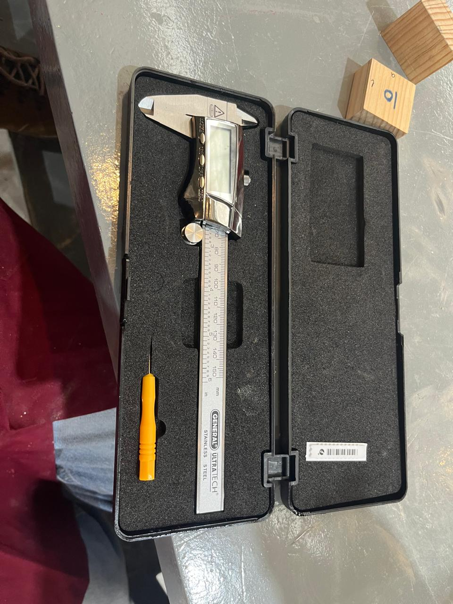  
*Figura 1: Vernier digital.*

### 2.2. Micrómetro (Pálmer)
Dispositivo basado en un tornillo micrométrico diseñado para medir dimensiones con una precisión milimétrica superior (resolución de $0.01\text{ mm}$ o $0.001\text{ mm}$). Cuenta con un trinquete de fricción para asegurar una fuerza de apriete constante y evitar deformaciones en la pieza.
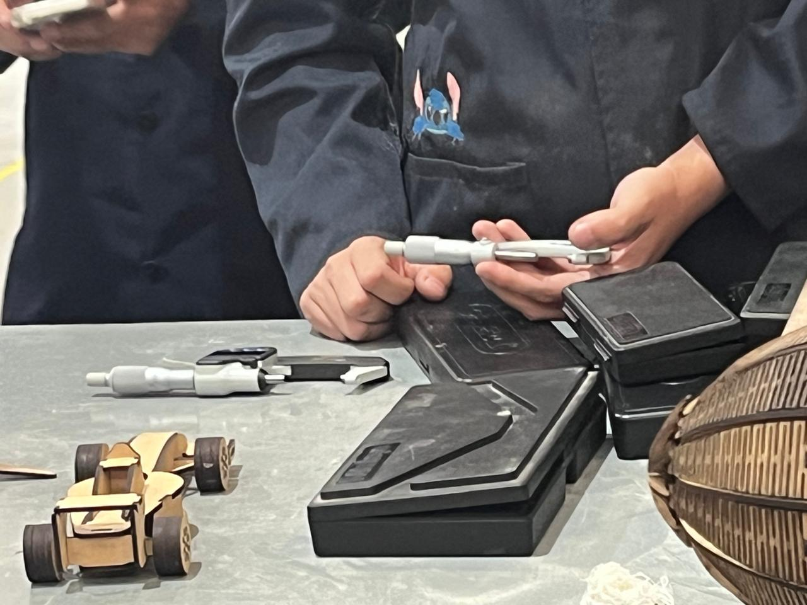  
*Figura 2: Micrómetro.*

### 2.3. Registro Experimental de Mediciones en Cubos de Prueba

#### Mediciones con Micrómetro (Resolución en milésimas de milímetro, $\text{mm}$)
| Intento / Lado | Lectura 1 ($\text{mm}$) | Lectura 2 ($\text{mm}$) | Promedio ($\text{mm}$) |
| :---: | :---: | :---: | :---: |
| **Eje X** | - | - | - |
| **Eje Y** | - | - | - |
| **Eje Z** | - | - | - |

#### Mediciones con Calibrador Vernier (Resolución en centésimas de milímetro, $\text{mm}$)
| Intento / Lado | Lectura 1 ($\text{mm}$) | Lectura 2 ($\text{mm}$) | Promedio ($\text{mm}$) |
| :---: | :---: | :---: | :---: |
| **Eje X** | - | - | - |
| **Eje Y** | - | - | - |
| **Eje Z** | - | - | - |

#### Observaciones Metrológicas:
Se comprobó que el **micrómetro** ofrece mayor repetibilidad y menor margen de error en comparación con el calibrador vernier debido a su sistema de tornillo calibrado y su tope de fricción controlado.
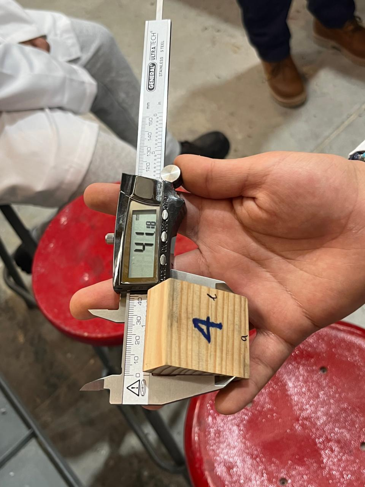  
*Figura 3: Cubo número 4 medido con el Vernier.*
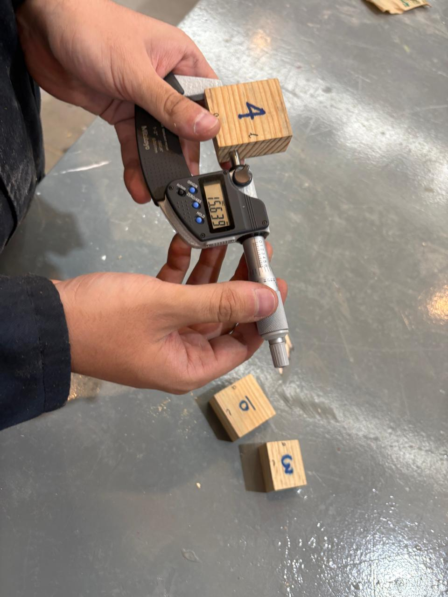  
*Figura 4: Cubo número 4 medido con el Micrómetro.*

---

## 3. Maquinaria de Corte y Maquinado

### 3.1. Fresadora e Instrumentos de Corte

#### Diferencia Fundamental entre Fresa y Broca:
- **Broca:** Herramienta diseñada exclusivamente para realizar perforaciones axiales (hundimiento lineal vertical). Sus filos de corte se encuentran en la punta.
- **Fresa:** Herramienta multiproceso diseñada para realizar cortes tanto axiales como laterales y transversales. Posee filos tanto en la punta como en las paredes laterales, permitiendo contorneo, ranurado y planeado.
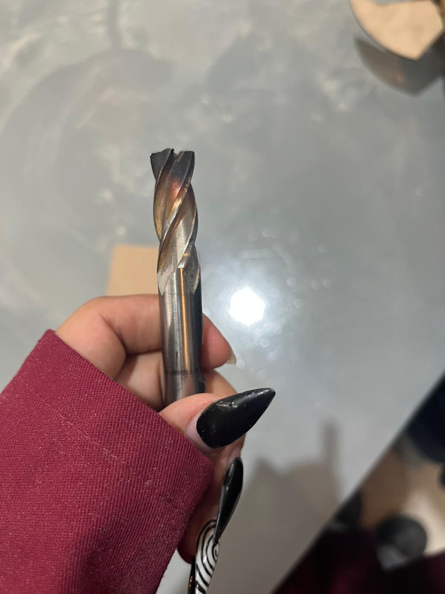  
*Figura 5: Inspección visual de una fresa de corte helicoidal.*

#### Reglas de Operación y Parámetros Técnicos en el Fresado:
1. **Sentido de giro y avance:** El avance del material debe realizarse en oposición al sentido de rotación de la fresa (*fresado en concordancia* o *en oposición*) para evitar tirones y asegurar la estabilidad del corte.
2. **Velocidad de corte ($RPM$):** Depende directamente del material a mecanizar y del diámetro de la herramienta. Materiales blandos requieren mayores revoluciones; materiales duros exigen velocidades menores.
3. **Sujeción de la pieza:** La pieza de trabajo debe estar firmemente asegurada en la mordaza de la fresadora mediante calzas de apoyo para evitar vibraciones o desprendimientos violentos.
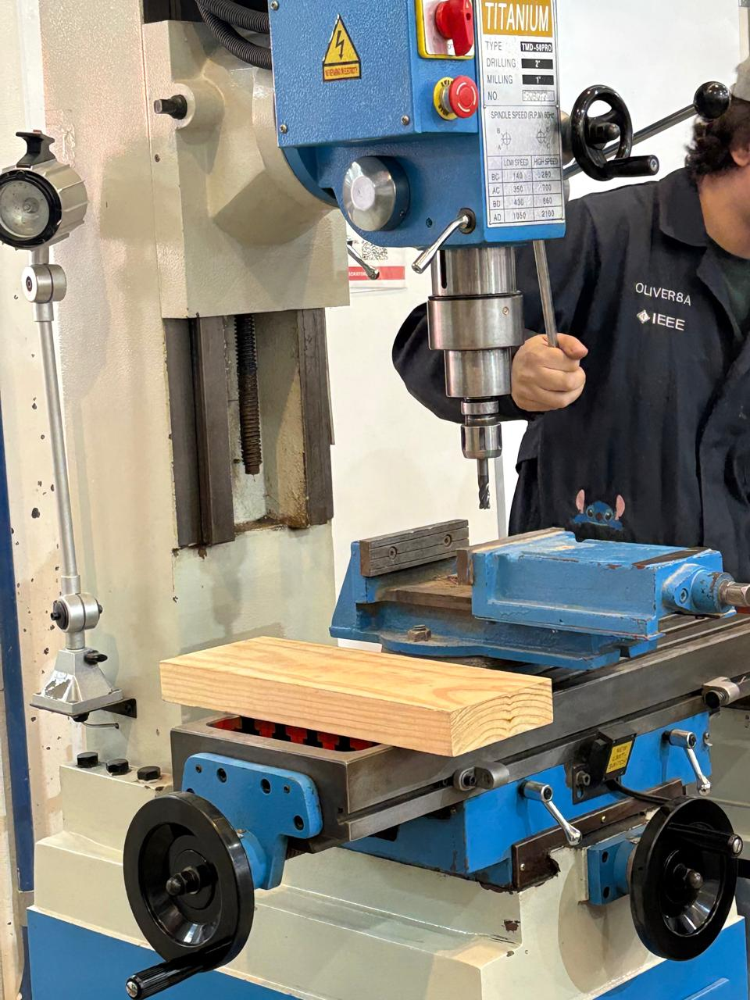  
*Figura 6: Máquina fresadora Titanium TMD-50PRO.*
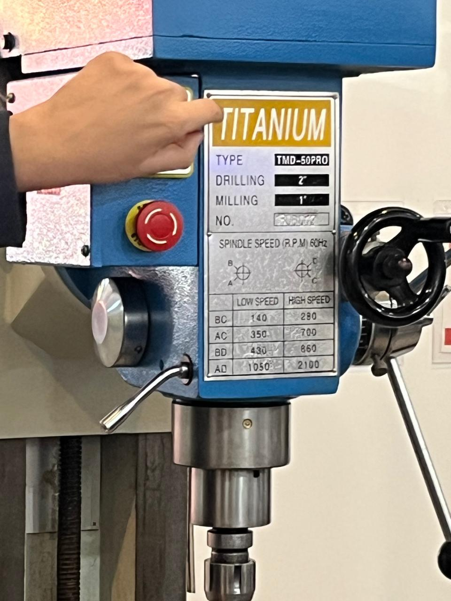  
*Figura 7: Panel de ajuste de velocidad de giro (RPM) de la fresadora.*

### 3.2. Sierra de Cinta para Madera
Utilizada para cortes rectos o curvos en bloques o tablas de madera y plásticos. Cuenta con una hoja fina en forma de cinta continua que circula sobre poleas. Es indispensable mantener las manos alejadas de la línea de corte y usar la guía paralela para cortes longitudinales estables.
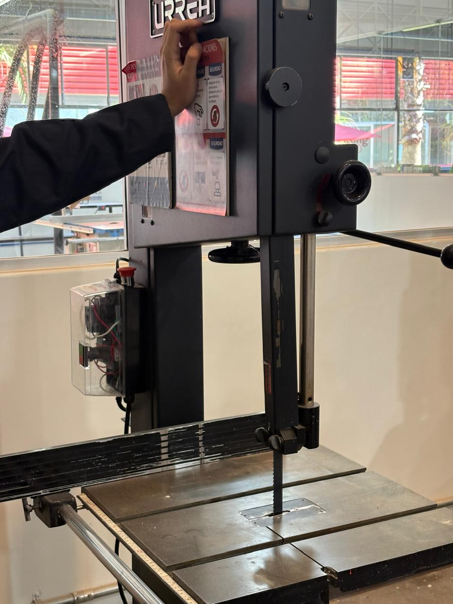  
*Figura 8: Sierra de cinta Urrea para cortes en madera.*

---

## 4. Deformación y Corte de Lámina Metálica

### 4.1. Guillotina Mecánica Manual para Lámina
Herramienta de banco destinada al corte recto de láminas metálicas de calibres delgados. 
- **Procedimiento:** Se alinea la marca de trazo con la línea de corte de la cuchilla, se acciona el pisón de retención para evitar que la lámina vibre o se levante, y se aplica fuerza uniforme en la palanca de corte en un solo movimiento fluido.
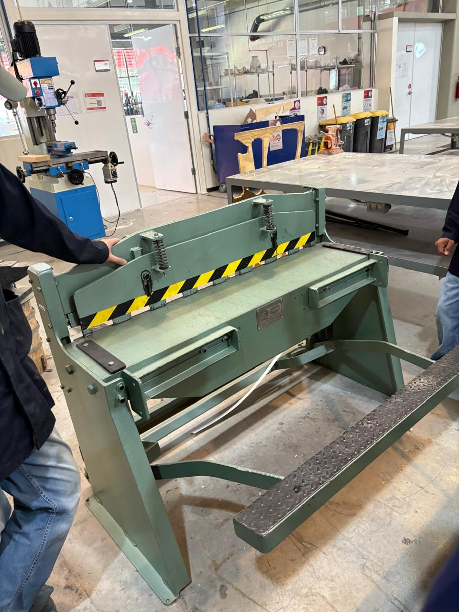  
*Figura 9: Guillotina mecánica manual para lámina metálica.*

### 4.2. Dobladora de Lámina (Prensa de Doblado)
Equipo empleado para deformar plásticamente láminas metálicas formando ángulos precisos.
- **Operación:** Se sujeta la lámina bajo la barra de presión superior y se acciona el faldón abatible para elevar el metal al ángulo de flexión deseado (por ejemplo, $90^{\circ}$), considerando siempre el factor de recuperación elástica (*springback*) del material.
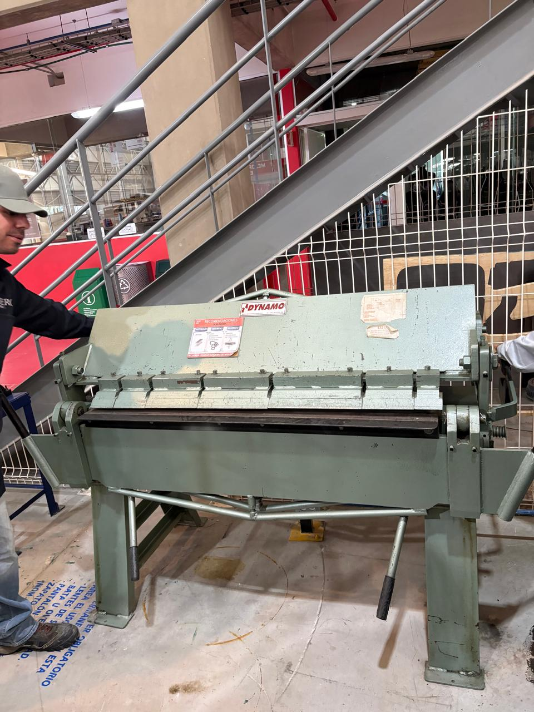  
*Figura 10: Dobladora Dynamo para láminas metálicas.*

---

## 5. Procesos de Unión: Soldadora por Puntos

La soldadora por puntos es un proceso de unión por resistencia eléctrica donde dos láminas metálicas se traslapan y se presionan fuertemente entre dos electrodos de cobre. 
- Al aplicar una corriente eléctrica de alta intensidad y bajo voltaje durante un breve lapso de tiempo, la resistencia eléctrica propia del punto de contacto genera calor localizado ($Q = I^2 R t$), fundiendo y uniendo ambas placas de manera localizada sin necesidad de material de aporte.
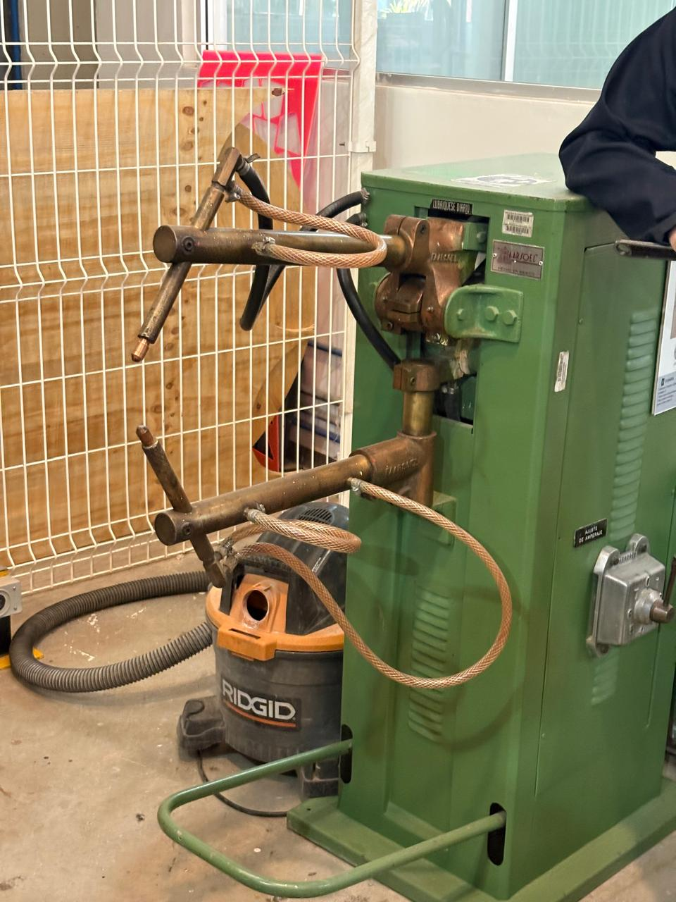  
*Figura 11: Equipo de soldadura por puntos por resistencia con electrodos de cobre y selector de amperaje.*

---

## 6. Conclusión

Esta práctica en el IDIT permitió familiarizarnos de forma directa con la infraestructura del laboratorio. Comprendimos la importancia de dominar instrumentos de medición de alta precisión como el micrómetro y el calibrador vernier para el control de calidad, así como el funcionamiento, reglas operativas y medidas de seguridad de las principales máquinas herramientas empleadas en los procesos de manufactura mecatrónica.