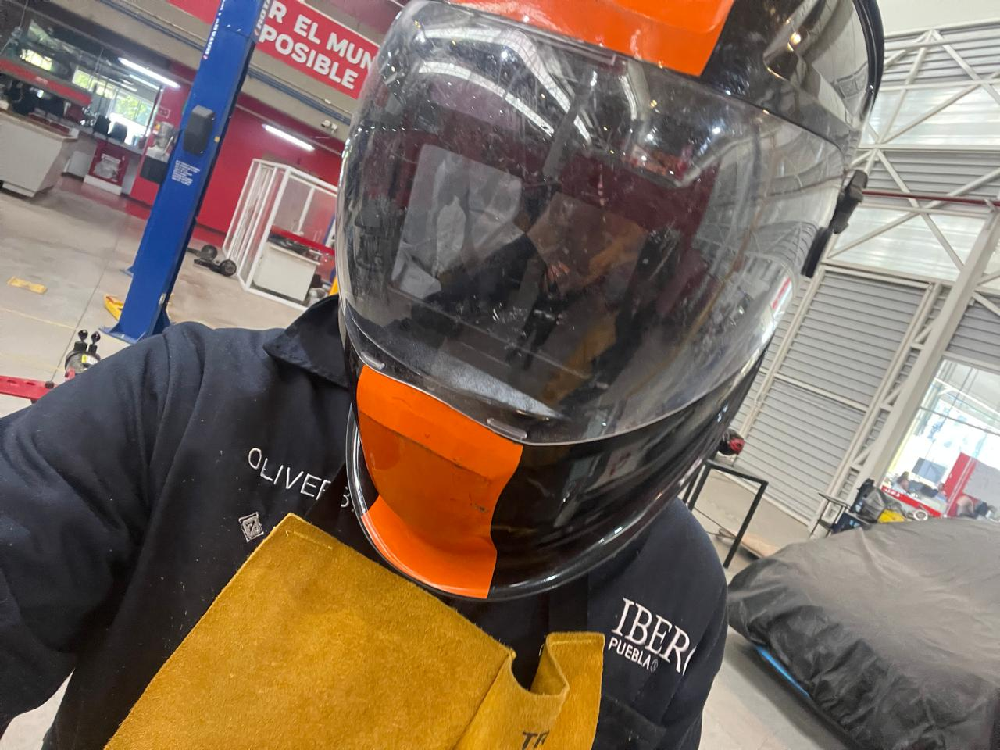

# Reporte de Práctica: Introducción al Soldado, Corte y Desbaste de Metales

**Institución:** IBERO Puebla 
**Clase:** Proyecto de Ingeniería I
**Fecha:** 28 de Agosto de 2026  

---

## 1. Equipo de Protección Personal (EPP) y Medidas de Seguridad

Antes de empezar a trabajar en el taller, revisamos las reglas de seguridad que son obligatorias para no sufrir ningún accidente. El equipo que necesitamos llevar puesto incluye:

- **Protección corporal:** Bata de laboratorio o preferentemente overol, pechera de cuero y guantes de cuero pesados para evitar quemaduras por chispas y metal caliente.
- **Protección ocular y facial:** Lentes de seguridad y careta para soldar, esto para cuidar los ojos de las luces fuertes y la radiación que suelta la soldadura.
- **Protección en extremidades:** Botas con casquillo para evitar golpes si se nos cae algo pesado en los pies.
- **Seguridad general:** Traer el cabello bien amarrado para que no se atore en las máquinas ni le caigan chispas.

---

## 2. Configuración de la Máquina de Soldar y Técnica de Soldadura

Los profesores Cholula y Oliver nos enseñaron cómo conectar y preparar la máquina de soldar, además de la forma correcta de usarla:

1. **Conexión de la máquina:** Nos mostraron dónde va la pinza de tierra (que se conecta a la mesa de metal) y el portaelectrodo (que es la pieza que sostiene la varilla para soldar).

2. **Ajuste de voltaje y corriente:**
   - **Voltaje elevado:** La varilla se derrite demasiado rápido. Si no movemos la mano a buena velocidad, podemos hacerle un hoyo a la pieza.
   - **Voltaje bajo:** La varilla de soldar se queda pegada al metal.
   - **Conclusión:** Hay que ir probando y ajustando los botones según el grosor del metal con el que vayamos a trabajar.
3. **Técnica de soldado:**
   - Es obligatorio ponerse la careta y revisar que los compañeros de al lado también la tengan puesta antes de empezar a soldar.
   - Hay que mover el electrodo de forma despacio y pareja.
   - Si alejamos mucho la varilla, la soldadura no agarra bien; si avanzamos muy rápido, queda chueca o incompleta; y si nos quedamos parados en un solo punto, perforamos la pieza.

---

## 3. Uso de Cortadoras de Metal

Nos explicaron qué tipos de cortadoras hay en el taller y cómo se debe cortar el metal correctamente:

- **Tipos de cortadora:**
  - Cortadora con disco dentado.
  - Cortadora con disco abrasivo (tipo lija que desgasta el material hasta cortarlo).
- **Procedimiento:**
  - Se fija adecuadamente el tubo o barra metálica usando la prensa que trae la misma máquina.
  - Se ejecuta el corte en **un solo movimiento fluido y continuo**. Si se interrumpe o se intenta cortar en múltiples pasadas, el material puede cristalizarse o perder la calidad del corte.
  - Se debe mantener el equipo de protección en todo momento, ya que la fricción desprende chispas constantes.

---

## 4. Desbaste y Limpieza de Piezas (Esmeril y Lija)

Una vez realizados los cortes, se procedió a retirar las imperfecciones del material:

- **Esmeril:** Se utilizó para retirar las rebabas y emparejar los bordes de los perfiles cortados.
- **Lija para metal:** El profesor Cholula enseñó la técnica de lijado manual para desbarbar o limpiar las piezas en caso de no disponer de un esmeril de banco.

---

## 5. Práctica Aplicada

Para finalizar la sesión, se pusieron en práctica los conceptos aprendidos:
1. Se realizaron cortes en tubos metálicos aplicando el procedimiento de fijación en prensa.
2. Se desbarbaron las piezas cortadas empleando el esmeril y la lija de metal.
3. Se llevaron las piezas preparadas a la mesa de trabajo para intentar unirlas mediante soldadura por arco eléctrico.

---

## 6. Bitácora de Fallas y Diagnósticos

| Actividad / Proceso | Falla o Dificultad Presentada | Causa Identificada | Solución / Aplicación Práctica |
| :--- | :--- | :--- | :--- |
| **Corte con disco abrasivo** | El corte quedó ligeramente desviado y al inicio no tenia el posicionamiento correcto. | Movimiento interrumpido a la mitad del corte por falta de firmeza en el pulso. | Sujetar con mayor firmeza la pieza en la prensa y ejecutar el descenso en un solo movimiento continuo. |
| **Soldadura por arco** | La varilla se pegaba constantemente a la placa base al intentar iniciar el arco. | Corriente de salida muy baja en la configuración del equipo. | Ajustar y calibrar el amperaje de la máquina de soldar al nivel adecuado para el espesor del electrodo. |
| **Cordón de soldadura** | Porosidad y acumulación irregular de material en ciertos tramos de la unión. | Velocidad de avance demasiado rápida o distancia excesiva del arco. | Mantener la mano firme, cuidar una distancia corta y constante entre la punta y la pieza. |

---

## 7. Aprendizajes del Taller

Durante esta práctica comprendimos la importancia de cumplir adecuadamente con las normas de seguridad e higiene (EPP) al operar equipos de riesgo como el esmeril de banco y la máquina de soldar. Asimismo, aprendimos a configurar los parámetros de corriente en el equipo, a manejar las cortadoras de metal con precisión y a desarrollar el pulso necesario para lograr una buena unión mediante el proceso de soldadura por arco eléctrico.

---

## 8. Anexos y Evidencia Fotográfica

A continuación se presentan las evidencias fotográficas recabadas durante la sesión, donde se observa el equipo de protección utilizado, las herramientas empleadas y las piezas soldadas.

### 8.1. Equipo de Protección Personal (EPP)

*Figura 1: Estudiante equipada con la vestimenta requerida: careta para soldar Truper, bata/overol, pechera de cuero y guantes de carnaza.*

---

### 8.2. Conexión de Seguridad Eléctrica
  
*Figura 2: Proceso de conexión de la clavija industrial a la toma eléctrica autorizada del taller, utilizando guantes de protección en todo momento.*

---

### 8.3. Material de practica ya soldado
  
*Figura 3: Material que fue utilizado durante la practica de soldadura.*

---

### 8.4. Cortadora de metal
  
*Figura 4: Maquina utilizada para la practica de corte de perfiles metalicos.*

  
*Figura 5: Perfiles metalicos ya cortados.*