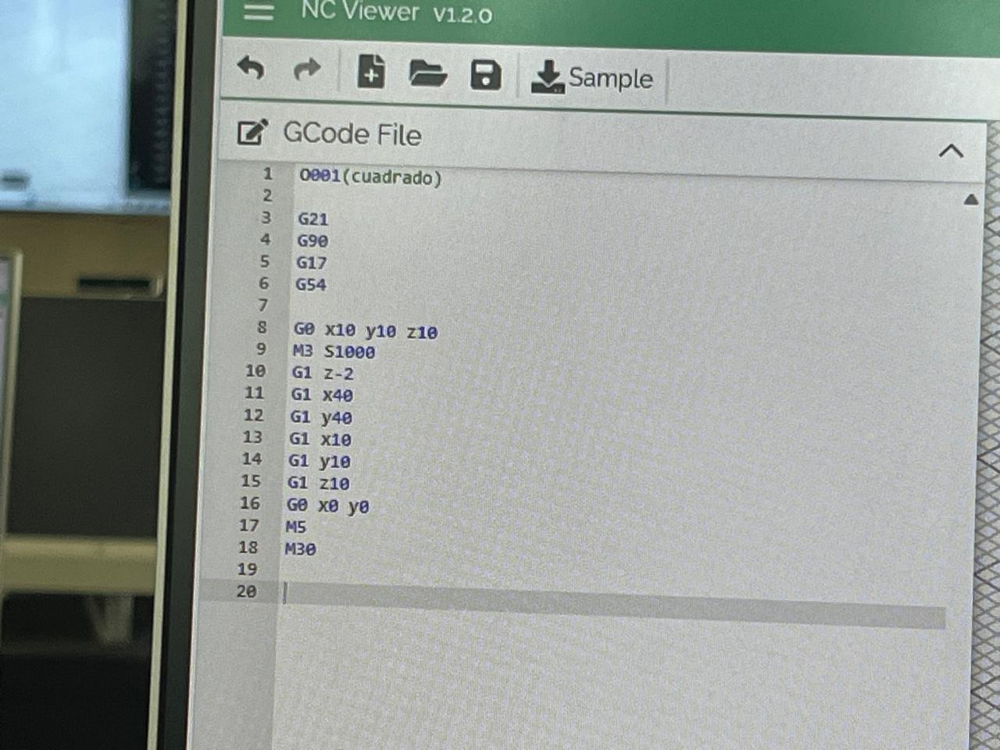
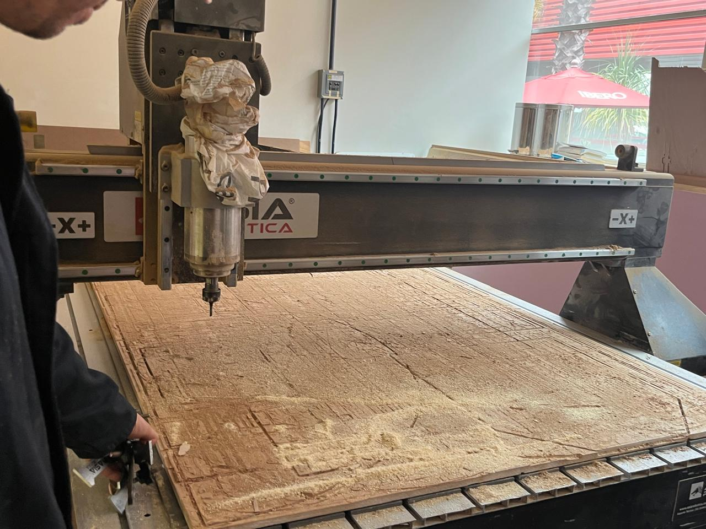
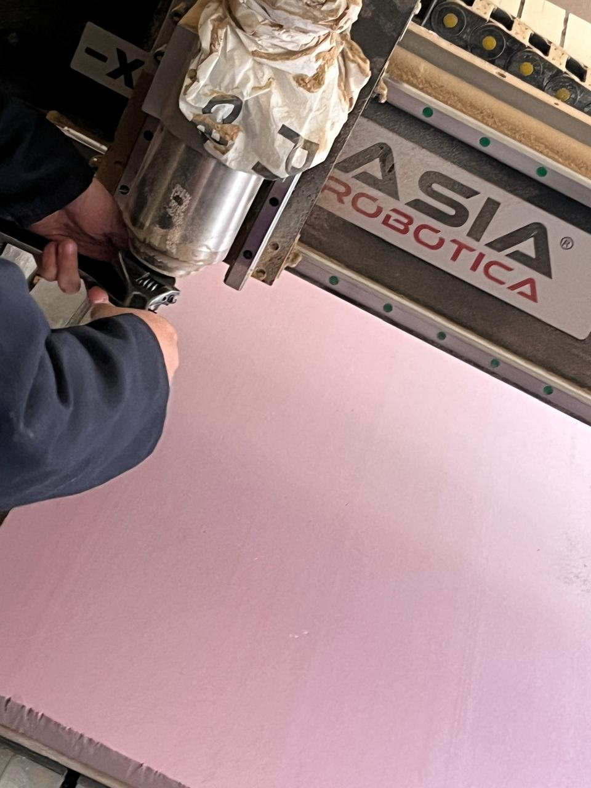
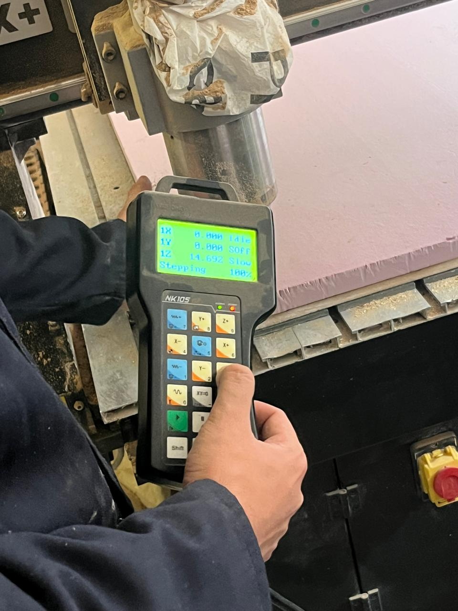
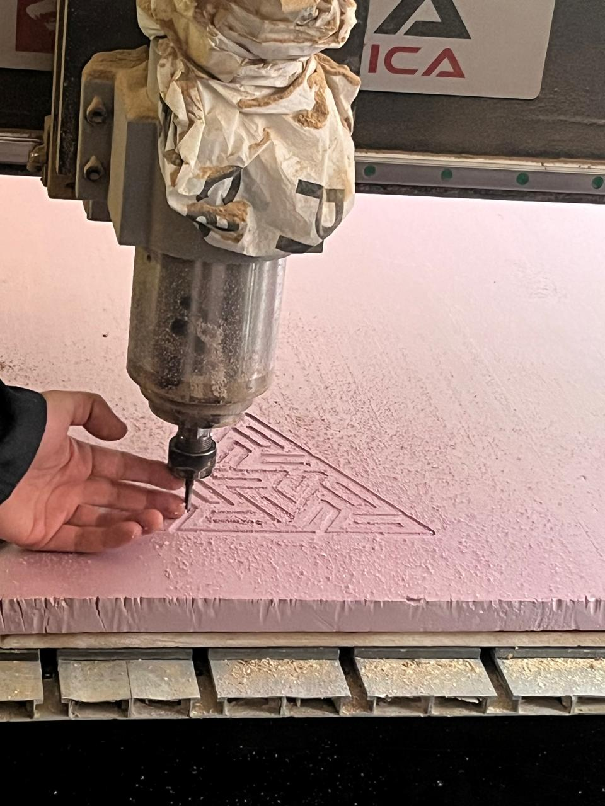
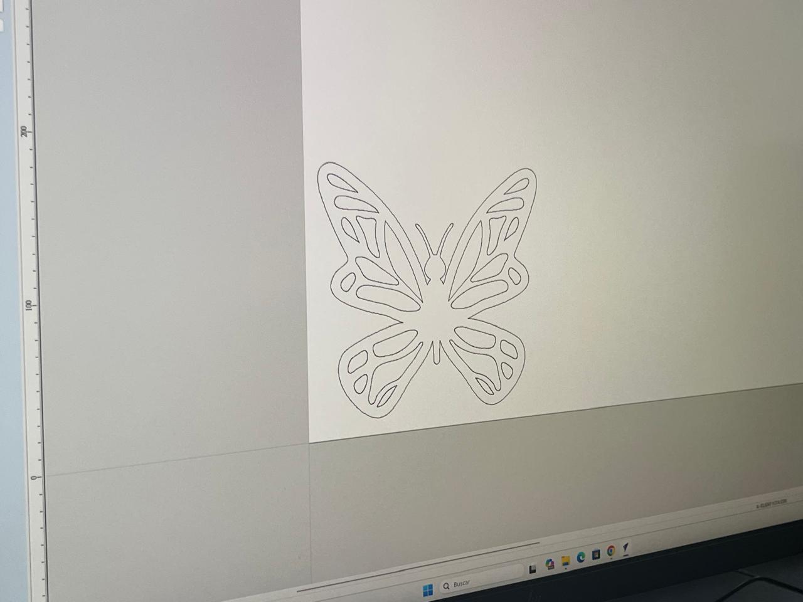
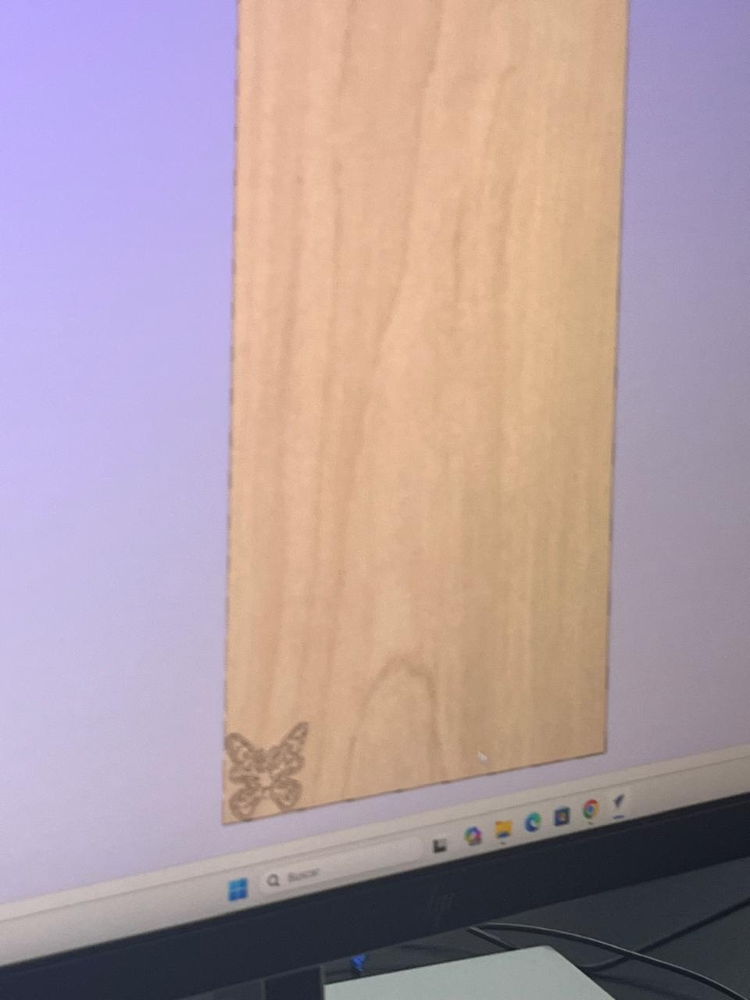
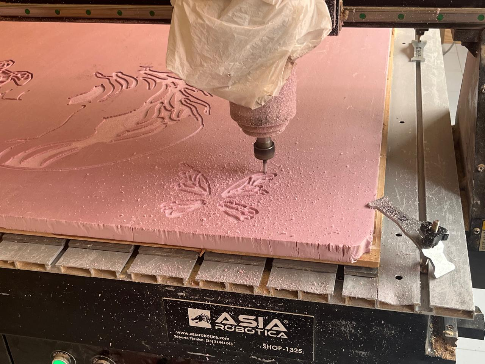

# Reporte de Práctica: Maquinado Controlado por Computadora (CNC)

**Institución:** IBERO Puebla
**Clase:** Proyecto de Ingeniería I 
**Fecha:** 02 y 09 de Octubre de 2026

---

## 1. Introducción y Protocolo de Seguridad (Lab's Safety Training)

El manejo de equipos de control numérico computarizado (CNC) de alta potencia, como los routers de corte, requiere la aplicación estricta de normas de seguridad industrial para proteger la integridad del operador y salvaguardar la maquinaria.

### 1.1 Equipo de Protección Personal (EPP) y Vestimenta
- **Protección ocular obligatoria:** Uso permanente de gafas de seguridad para prevenir lesiones por proyección de virutas de madera, MDF o acrílico a alta velocidad.
- **Protección auditiva:** Empleo de tapones u oJeras para mitigar el ruido continuo generado por el husillo (*spindle*) y la fricción de la herramienta de corte.
- **Control de indumentaria:** Cabello completamente recogido, prohibición absoluta de mangas sueltas, pulseras, anillos o cadenas que puedan ser atrapados por el cabezal en rotación.
- **Calzado industrial:** Zapatos cerrados o botas de seguridad con casquillo.

### 1.2 Reglas de Operación y Entorno
- **Botón de Paro de Emergencia (*E-Stop*):** Localizar visualmente el botón rojo de emergencia antes de iniciar cualquier código de maquinado.
- **Supervisión constante:** Nunca abandonar la máquina mientras el cabezal esté en movimiento o ejecutando un archivo de corte.
- **Limpieza de área:** Mantener el área de trabajo libre de obstrucciones y herramientas sueltas sobre la bancada.

### 1.3 Extracción de Polvo y Gestión de Carga Estática
- **Sistema de aspiración activa:** Es obligatorio encender el sistema de extracción de aire y polvo antes de iniciar el corte para evitar la acumulación de residuos combustibles o particulado suspendido.
- **Prevención de estática:** En materiales plásticos o acrílicos, se debe verificar la descarga adecuada para evitar descargas o acumulación de viruta estática adherida.

---

## 2. Especificaciones de los Routers CNC (Fab Lab Puebla)

El laboratorio cuenta con sistemas de corte CNC orientados al prototipado a gran escala y fabricación digital:
- **ShopBot Desktop / Standard:** Router CNC de tres ejes ($X, Y, Z$) controlado por computadora, ideal para el corte y grabado de tableros de madera, triplay, MDF, plásticos de ingeniería y espumas.
- **Sistema de Transmisión:** Mecanismo de piñón y cremallera (*rack and pinion*) en los ejes horizontales y husillo de bolas en el eje vertical $Z$.
- **Husillo (*Spindle*):** Motor de alta frecuencia refrigerado por aire o líquido, con control de velocidad variable de rotación.

---

## 3. Catálogo de Materiales y Recomendaciones de Maquinado

| Material | Velocidad de Giro (*RPM*) | Velocidad de Avance (*Feed Rate*) | Tipo de Fresa Recomendada |
| :--- | :---: | :---: | :--- |
| **MDF / Triplay** | $12,000 - 15,000$ | $3,000 - 4,500\text{ mm/min}$ | Fresa de dos filos rectos o espiral ascendente (*Upcut*). |
| **Acrílico (PMMA)** | $10,000 - 12,000$ | $2,000 - 3,000\text{ mm/min}$ | Fresa de un solo filo (*Single Flute*) para evitar fundición. |
| **Madera Dura** | $14,000 - 18,000$ | $2,500 - 3,500\text{ mm/min}$ | Fresa de carburo de tungsteno en espiral. |
| **Foam / Poliestireno** | $16,000 - 20,000$ | $5,000 - 8,000\text{ mm/min}$ | Fresa de corte recto de alta velocidad. |

---

## 4. Pruebas de Calibración y Caracterización de Parámetros

### 4.1 Prueba de Descentramiento (*Runout Test*)
El descentramiento radial del husillo o de la herramienta provoca vibraciones excesivas, acabados superficiales deficientes y ruptura prematura de fresas. Se verifica midiendo con un reloj comparador magnético en la caña de la herramienta, asegurando una excentricidad menor a $0.02\text{ mm}$.

### 4.2 Tabla de Avances y Velocidades (*Feeds and Speeds - ShopBot*)

#### Caracterización de Herramientas:
La velocidad de corte se calcula en función del diámetro de la herramienta, el número de filos y la velocidad de avance para evitar la fatiga térmica del material y de la fresa.

---

## 5. Reglas de Diseño y Estrategias de Corte

### 5.1 Ensamble y Modificaciones Geométricas (*Dogbones y T-bones*)
Debido a la geometría cilíndrica de las fresas de corte, las esquinas interiores de una caja o encastre mecánico quedan redondeadas con un radio igual al de la herramienta, impidiendo que piezas rectangulares embonen perfectamente.
- **Dogbone / T-bone:** Son pequeños alivios o cortes circulares excedentes diseñados en las esquinas de los vectores CAD para permitir que las esquinas de las piezas emparejen sin interferencias.

### 5.2 Tipos de Operaciones en Software CAM
- **Contorneo (*Profile*):** Corte exterior o interior siguiendo la trayectoria del vector (con compensación de herramienta a la izquierda o derecha).
- **Vaciado (*Pocket*):** Remoción de todo el material comprendido en el interior de un límite cerrado a una profundidad específica.
- **Grabado (*Engraving*):** Trazado de líneas o textos mediante herramientas de punta cónica.

### 5.3 Sistemas de Fijación (*Fixtures*)
Es fundamental asegurar firmemente el material a la cama de sacrificio mediante:
- **Tornillos de sujeción (*Screws*):** Colocados estratégicamente fuera de la ruta de corte.
- **Cinta doble cara industrial:** Utilizada para piezas delgadas de acrílico o madera donde no se pueden usar tornillos superficiales.

---

## 6. Programación y Control en G-Code

### 6.1 Sintaxis y Diccionario de Comandos G-Code
- **`G00`**: Movimiento rápido en vacío hacia coordenadas específicas.
- **`G01`**: Movimiento de corte lineal controlado a una velocidad de avance determinada (`F`).
- **`G02 / G03`**: Interpolación circular en sentido horario (`G02`) o antihorario (`G03`).
- **`G20 / G21`**: Selección de unidades en pulgadas (`G20`) o milímetros (`G21`).
- **`M03`**: Encendido del husillo en sentido horario.
- **`M05`**: Apagado del husillo.

### 6.2 Simulación en Plataforma Digital (NC Viewer)
Antes de enviar cualquier programa al router CNC físico, se validaron las trayectorias de maquinado en simuladores web como *NC Viewer* para verificar la ausencia de errores en las alturas de retracción ($Z$) y límites de área.
  
*Figura 1: Código G utilizado en NC Viewer para formar una figura.* 


#### Ejemplo: Trazo de Estrella de 5 Puntas
```gcode
G21 ; Unidades en milímetros
G90 ; Coordenadas absolutas
M03 S12000 ; Encender husillo a 12000 RPM
G00 X0 Y0 Z5 ; Posicionamiento rápido inicial
G01 Z-2 F500 ; Penetración de corte a 2 mm de profundidad
G01 X20 Y50 F1500 ; Línea de trayectoria 1
G01 X40 Y0 ; Línea de trayectoria 2
G01 X0 Y30 ; Línea de trayectoria 3
G01 X50 Y30 ; Línea de trayectoria 4
G01 X20 Y0 ; Cierre de geometría de estrella
G00 Z10 ; Retracción segura
M05 ; Apagado de husillo
M30 ; Fin del programa

```

## 7. Conclusión

La práctica impartida en Fab Lab Puebla por el Mtro. Oliver permitió comprender de manera integral el proceso de maquinado CNC:

1. **Seguridad operacional:** Normativa estricta sobre EPP y prevención de riesgos mecánicos y mecánico-eléctricos.
2. **Parámetros de corte:** Selección informada de velocidades de avance ($F$) y rotación ($RPM$) ajustadas a las propiedades del material.
3. **Estrategia CAD/CAM:** Implementación de *t-bones*/*dogbones* y puentes de sujeción (*tabs*).
4. **Programación G-Code:** Comprensión e interpretación de comandos G y M para movimientos lineales, arcos y simulación previa mediante herramientas virtuales como NC Viewer.

---

## 8. Galería Fotográfica y Evidencia de Práctica — Maquinado CNC

A continuación se presentan las evidencias visuales del proceso completo realizado en el Fab Lab Puebla (Ibero Puebla):

### 8.1. Router CNC y Cama de Sacrificio
   
*Figura 2: Lámina de material sobre la cama de sacrificio (tablero de madera inferior diseñado para recibir posibles sobrecortes o pasadas en profundidad de la fresa sin dañar la estructura metálica de la máquina).*

---

### 8.2. Cambio y Ajuste de Herramienta
    
*Figura 3: Procedimiento de cambio y apriete de la herramienta de corte para asegurar el correcto bloqueo del mandril (collet) y la fresa.*

---

### 8.3. Consola de Control y Calibración (NK105)
  
*Figura 4: Controlador portátil NK105 utilizado para el posicionamiento manual de los ejes (*Jog*), definición de ceros de pieza, calibración y supervisión de las coordenadas de trabajo ($X, Y, Z$).*

---

### 8.4. Resultado primera práctica grupal 
    
*Figura 5: Muestra de el proceso de corte de el router y resultado final de la práctica realizada en clase.*

---

### 8.5. Segundo Corte: Proyecto Mariposa
  
*Figura 6a: Visualización en 2D del modelo de la mariposa en VCarve Pro.*

   
*Figura 6b: Visualización en 3D de la simulación de corte de la mariposa en VCarve Pro.*

   
*Figura 6c: Proceso de corte de la mariposa en la máquina CNC.*

---

## Descargas

- 📦 [Descargar modelo Mariposa.crv (.zip)](../img/Mariposa.zip)